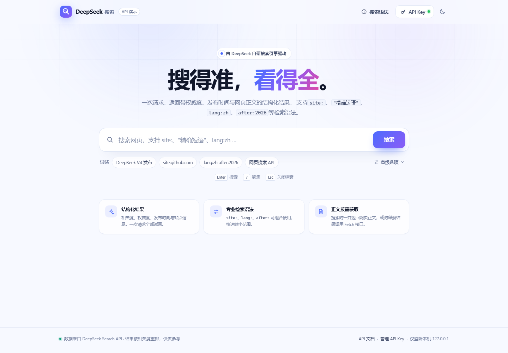

# DeepSeek 搜索 · 网页搜索演示

一个零依赖、开箱即用的 **DeepSeek Search API** 网页前端。输入关键词，即可拿到带相关度、权威度、发布时间、站点信息与可选网页正文的结构化结果。



> 预览：[搜索结果](docs/preview.png) · [深色模式](docs/dark.png) · [移动端](docs/mobile.png) · [API Key 设置](docs/key-dialog.png) · [错误状态](docs/error-state.png)。截图使用本地桩数据或无效 Key，不消耗 API 额度。非官方项目，仅用于 API 演示。

## 功能

- **网页搜索**：调用 `POST /v1/tools/search`，单次 1–50 条，支持 `site:`、`-site:`、`"精确短语"`、`-词`、`lang:`、`after:`、`before:` 等检索语法。
- **结构化结果**：标题、站点图标、发布时间、相关度评分（0–3）、权威度（0–4）、短摘要与长摘要。
- **筛选与排序**：按「优质（≥1.5）」「权威（≥3）」筛选，按相关度 / 最新 / 权威度排序。
- **按需抓取正文**：对单条结果调用 `POST /v1/tools/fetch`，无需重新搜索；也可在搜索时直接勾选 `need_content`。
- **搜索语法面板**：内置操作符速查表，示例可一键填入搜索框。
- **本地密钥保护**：浏览器不直接请求 `api.deepseek.com`，由本地 Node 服务同源代理转发，规避 CORS 与密钥暴露；服务端不写日志、不落盘。
- **细节体验**：深浅色主题、骨架屏、错误码中文提示、搜索历史、URL 可分享（`?q=`）、键盘快捷键（`/`、`Ctrl/Cmd + K`、`Esc`）、移动端适配。

## 快速开始

环境要求：**Node.js ≥ 20**（项目不依赖任何 npm 包，无需 `npm install`）。

```bash
cd deepseek-search

# 1. 配置 Key（二选一）
#    方式 A：复制环境变量示例并填入 Key
copy .env.example .env      # macOS / Linux: cp .env.example .env
#    方式 B：启动后在页面右上角「API Key」中填写

# 2. 启动
npm start
```

打开 **http://127.0.0.1:8787** 即可搜索。

> 端口被占用时：在 `.env` 中设置 `PORT=8788`，或 PowerShell 中执行 `$env:PORT=8788; npm start`。

## 工作原理

```text
浏览器（同源 fetch /api/search）
        │  X-DeepSeek-Key（可选）
        ▼
本地 Node 代理 127.0.0.1:8787
        │  Authorization: Bearer <key>
        ▼
https://api.deepseek.com/v1/tools/search
```

- 页面只与本地服务通信，不存在跨域问题；
- API Key 可由浏览器提供（存于 `localStorage`）或服务端 `.env` 提供，**浏览器 Key 优先**；
- 代理仅监听 `127.0.0.1`，不会对局域网开放；
- 响应经统一规范化后返回，并附带本次上游耗时 `elapsed_ms`。

## 参数映射

| 界面项 | API 字段 | 说明 |
| --- | --- | --- |
| 搜索框 | `query` | 必填，1–128 个字符，前端与服务端双重校验 |
| 返回条数 | `count` | 1–50，默认 10 |
| 原始问题 | `ori_question` | 可选，≤128 字符，帮助理解搜索意图 |
| 本地化 IP | `localization` | 可选，优先返回该地区结果 |
| 返回网页正文 | `need_content` | 布尔值，默认 `false` |

服务端会过滤未知字段、校验类型与长度，并限制请求体为 64 KB。

## 错误码

| HTTP | 含义 | 页面提示 |
| --- | --- | --- |
| 400 | 请求头 / 请求体不合法 | 请求参数有误 |
| 401 | Key 缺失或无效 | API Key 无效或未配置 |
| 402 | 账户余额不足 | 账户余额不足 |
| 403 | 请求被安全策略拒绝 | 请求被拒绝 |
| 408 | 读取请求体超时 | 请求超时 |
| 413 | 请求体过大 | 请求体过大 |
| 429 | 超过 QPS 限制 | 请求过于频繁（Search 100 QPS） |
| 500 / 504 | 上游异常 / 超时 | 服务异常，可重试 |

前端提供「重试」按钮；对 408、429、5xx 可直接重试，其它 4xx 需先调整请求（例如更换 API Key）再试。

## 计费说明

Search 与 Fetch 均**按成功请求次数**计费，与 `count` 无关：

- 每 1,000 次成功请求 **5 元**；
- 只有 HTTP 200 且 `results` 非空（Search）或返回正文（Fetch）才计费；
- 失败、无结果与超时不计费。

本项目不会自动重试，也不会在后台轮询，避免产生预期外的调用。

## 目录结构

```text
deepseek-search/
├─ server.js              # 零依赖本地服务：静态托管 + API 同源代理
├─ public/
│  ├─ index.html          # 页面结构
│  ├─ styles.css          # 深浅色主题与响应式样式
│  ├─ app.js              # 搜索、渲染、筛选、抓取正文、Key 管理
│  ├─ boot.js             # 首屏前应用主题，避免闪白
│  └─ favicon.svg
├─ test/
│  ├─ stub-upstream.mjs   # 开发用上游桩服务（无 API 费用）
│  ├─ cdp-check.mjs       # 可选：Edge 无头验收脚本（点击、截图、断言）
│  └─ run-browser-check.ps1
├─ docs/                  # 预览截图（首页、结果、深色、移动端、错误状态）
├─ .env.example
└─ package.json
```

## 本地联调（无需真实 Key）

仓库内置一个返回示例数据的上游桩服务，可完整验证搜索、筛选、正文抓取与错误状态：

```bash
# 终端 1
npm run stub

# 终端 2（PowerShell）
$env:DEEPSEEK_BASE_URL="http://127.0.0.1:8799"
$env:DEEPSEEK_API_KEY="sk-stub"
npm start
```

打开 http://127.0.0.1:8787/?q=DeepSeek%20V4 即可看到结果。

## 浏览器验收（可选）

`test/cdp-check.mjs` 通过 Edge 的 DevTools 协议做真实交互检查：渲染结果、展开详情、抓取正文、筛选排序、深浅色、移动端布局、API Key 弹窗与首次配置流程，并生成 `docs/` 下的截图。

先按上一节启动桩服务与应用，然后运行：

```powershell
powershell -ExecutionPolicy Bypass -File test/run-browser-check.ps1
```

需要本机安装 Edge；脚本会临时启动一个无头浏览器实例，不是运行项目的必要条件。要同时验证「未配置 Key」的首次使用流程，可用 `-KeyflowUrl http://127.0.0.1:8789/` 指向一个未设置 `DEEPSEEK_API_KEY` 的实例。

## 安全说明

- 页面设置了 CSP、`X-Content-Type-Options`、`Referrer-Policy`、`frame-ancestors 'none'` 等响应头；
- 所有 API 文本均通过 `textContent` 渲染，并对链接协议做白名单校验，避免 XSS；
- 站外图标使用 `referrerpolicy="no-referrer"`，加载失败时回退为首字母；
- 若你将服务暴露到公网，请自行增加鉴权与限流——本项目按本机单用户场景设计。

## 已知限制

- 结果质量与覆盖范围取决于 DeepSeek 搜索服务，本页面不做额外二次排序（仅提供客户端筛选 / 排序）；
- 未实现流式结果与分页；Search API 单次最多 50 条；
- Fetch 的可用性受目标站点访问策略影响，失败时会给出提示而不是中断整个结果页。

## 许可

仅用于学习与演示。DeepSeek 名称与相关接口归 DeepSeek 所有，请遵循其服务条款。
